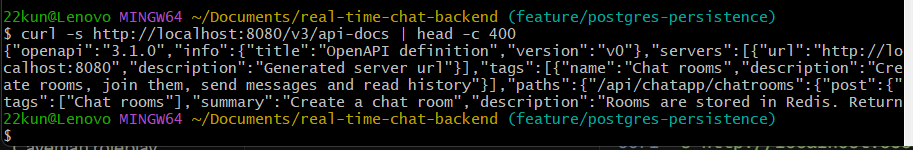

# Real-Time Chat Backend


Backend-only, multi-room chat service built with Java 17, Spring Boot, Redis Pub/Sub and PostgreSQL. It exposes four REST endpoints, stores chat history in PostgreSQL, and publishes every message on a Redis channel.

## What it does
- Create rooms, join them, send messages and read history over REST (4 endpoints).
- Sending a message saves it to PostgreSQL first, then publishes it on the Redis channel `chatroom`.
- Rooms and participants live in Redis. Chat history lives in PostgreSQL.
- A subscriber inside the app receives published messages and logs them. Nothing is pushed to connected clients yet (no WebSocket).

## Architecture

```
Client
  |  REST
  v
ChatRoomController
  |
  v
ChatRoomService
  |-- Redis: rooms (hash), participants (set)
  |-- PostgreSQL: chat_messages (history)
  |-- Redis publisher --> channel "chatroom" --> Redis subscriber (logs the message)
```

| Data | Store | Why |
|---|---|---|
| Rooms, participants | Redis (`CHAT_ROOMS` hash, `CHAT_ROOM:{room}:PARTICIPANTS` set) | Fast lookups |
| Message history | PostgreSQL table `chat_messages` | Durable, indexed, queryable |
| Live distribution | Redis Pub/Sub channel `chatroom` | Fan-out to subscribers |

Redis Pub/Sub has no acknowledgements or durability. A subscriber that is down misses messages. The database copy is why history survives.

## Tech stack

| Area | Technology |
|---|---|
| Language | Java 17 |
| Framework | Spring Boot 3.5, Spring Web, Spring Data JPA, Spring Data Redis |
| Datastores | PostgreSQL 16, Redis 7 |
| API docs | springdoc OpenAPI, Swagger UI |
| Tests | JUnit 5, Mockito, Testcontainers |
| Containers | Docker, Docker Compose |
| CI | GitHub Actions (no deployment step) |
| Load test | k6 |

## Getting started

Prerequisites: Java 17, Docker Desktop with Compose, Git. The Maven wrapper is included.

```bash
git clone https://github.com/Mohitkundu360/real-time-chat-backend.git
cd real-time-chat-backend
```

### Option A: whole stack in Docker
```bash
docker compose up -d --build
docker compose ps
```

| Service | Host port |
|---|---|
| App | 8080 |
| PostgreSQL | 5433 (container 5432) |
| Redis | 6380 (container 6379) |

No `.env` is needed. Copy `.env.example` to `.env` only to change the Postgres password. The password is set when the database volume is first created, so changing it later has no effect on an existing volume.

### Option B: app on your machine, infrastructure in Docker
```bash
docker compose up -d postgres redis
./mvnw spring-boot:run
```
Stop the app container first if it is running (`docker compose stop app`), because both use port 8080.

### Configuration
All values come from environment variables, with local defaults.

| Variable | Default |
|---|---|
| `DB_URL` | `jdbc:postgresql://localhost:5433/chatdb` |
| `DB_USERNAME` | `chat` |
| `DB_PASSWORD` | `chat` |
| `REDIS_HOST` | `localhost` |
| `REDIS_PORT` | `6380` |
| `REDIS_PASSWORD` | empty |

The defaults are local development values only. Never commit real credentials.

### Try it
```bash
curl -X POST http://localhost:8080/api/chatapp/chatrooms -H "Content-Type: application/json" -d '{"roomName":"engineering"}'
curl -X POST http://localhost:8080/api/chatapp/chatrooms/engineering/join -H "Content-Type: application/json" -d '{"participant":"Mohit"}'
curl -X POST http://localhost:8080/api/chatapp/chatrooms/engineering/messages -H "Content-Type: application/json" -d '{"participant":"Mohit","message":"Hello"}'
curl "http://localhost:8080/api/chatapp/chatrooms/engineering/messages?limit=10"
```

## API

| Operation | Method | Endpoint |
|---|---|---|
| Create a room | POST | `/api/chatapp/chatrooms` |
| Join a room | POST | `/api/chatapp/chatrooms/{roomId}/join` |
| Send a message | POST | `/api/chatapp/chatrooms/{roomId}/messages` |
| Read history | GET | `/api/chatapp/chatrooms/{roomId}/messages?limit=10` |

History returns the latest messages from PostgreSQL, oldest first. `limit` is clamped to 1-100.

Swagger UI: `http://localhost:8080/swagger-ui.html`. OpenAPI JSON: `http://localhost:8080/v3/api-docs`.



## Tests
```bash
docker compose up -d postgres redis
./mvnw clean test
```

18 tests:
- 13 Mockito unit tests (`ChatRoomServiceTest`): room checks, save-before-publish order, history ordering, limit clamping.
- 4 repository tests against a real PostgreSQL 16 container (`ChatMessageRepositoryTest`, Testcontainers): query order, page size, room isolation, and that the composite index exists. Docker must be running.
- 1 context test (`ChatappApplicationTests`): needs PostgreSQL and Redis reachable on 5433 and 6380. In CI they run as service containers.

Surefire runs the test JVM in UTC. Testcontainers is pinned to 1.21.4 for compatibility with Docker Engine 29.

## Index benchmark
Table `chat_messages` has a composite index on `(room_id, created_at)`, matching the history query (latest N messages for one room).

Local test: 200,000 messages across 50 rooms, PostgreSQL 16 in Docker, `EXPLAIN ANALYZE`, warm cache, single run each.

```sql
INSERT INTO chat_messages (room_id, participant, content, created_at)
SELECT 'room-' || (g % 50), 'user' || (g % 20), 'msg ' || g, now() - (g || ' seconds')::interval
FROM generate_series(1, 200000) g;
ANALYZE chat_messages;
EXPLAIN ANALYZE SELECT * FROM chat_messages WHERE room_id = 'room-7' ORDER BY created_at DESC LIMIT 10;
```

| Setup | Plan | Execution time |
|---|---|---|
| With the index | Index Scan Backward | about 0.05 ms |
| Index dropped | Parallel Seq Scan + top-N sort | about 8.9 ms |

Indicative only: one laptop, one run each.

## Load test
`load-test/` has the k6 script, setup notes and raw summaries. Profile: ramp to 100 virtual users over 80 seconds. Each iteration sends one message and reads history, with 0.5-1 s think time.

| Run | Requests | Failed | p95 overall | p95 send | p95 history |
|---|---|---|---|---|---|
| 1 | 11,872 | 0.00% | 14.97 ms | 16.78 ms | 11.58 ms |
| 2 | 11,974 | 0.00% | 11.21 ms | 12.76 ms | 8.18 ms |
| 3 | 11,972 | 0.00% | 10.91 ms | 12.27 ms | 7.89 ms |

Load was about 150 requests/s. k6, the app, PostgreSQL and Redis shared one laptop (Core i5-12450H, 15.7 GB), so treat this as indicative, not a capacity benchmark. The number of stored messages matched the number of accepted sends. That checks persistence, not Pub/Sub delivery. Details in [load-test/README.md](load-test/README.md).

## CI
GitHub Actions runs on pushes to `main` and `feature/**` and on pull requests:
- build and run all tests with PostgreSQL and Redis service containers
- build the Docker image

There is no deployment step.

## Project structure

```
src/main/java/com/example/chatapp/
  config/        Redis configuration
  controller/    REST endpoints and OpenAPI annotations
  model/         ChatMessage entity, ChatRoom
  pubsub/        Redis publisher and subscriber
  repository/    Spring Data JPA repository
  service/       business logic
src/test/        unit and integration tests
load-test/       k6 script, results, notes
docs/screenshots/
.github/workflows/ci.yml
docker-compose.yml, Dockerfile, .env.example
```

## Limitations
- No authentication or authorization.
- No WebSocket or STOMP client. Published messages are only logged by the in-app subscriber.
- Redis Pub/Sub gives no acknowledgements or durable delivery.
- Sending does not check that the sender joined the room. Request bodies are plain maps with minimal validation.
- Schema is managed by Hibernate `ddl-auto=update`, not versioned migrations.
- Swagger UI and `/v3/api-docs` are open. Secure or disable them in production.
- Not deployed anywhere. The load and index numbers come from one laptop.

## Next steps
- JWT authentication and room-level authorization
- WebSocket/STOMP delivery to connected clients
- Flyway or Liquibase migrations
- Request validation and error responses
- Metrics and structured logging

## Author
Mohit Kundu, backend engineer (Java, Spring Boot).
[GitHub](https://github.com/Mohitkundu360) | [LinkedIn](https://www.linkedin.com/in/mohitkundu-backend) | [Portfolio](https://portfolio-steel-mu-35.vercel.app/)

## License
MIT. See [LICENSE](LICENSE).
